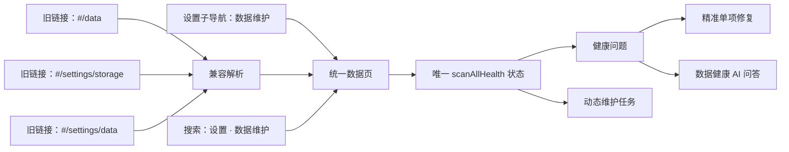

# WealthGrowthTracker 维护摘要（2026-11-20）

## 基线

- `v1.11.0-preview.2` 已是公开 Pre-release，不是 Draft；Tag 未移动、未复用。
- 本轮基于当时的 `main` 执行，不把 2026-11-11 以前的已发布状态重新当作缺陷。
- 当前版本号和历史 Tag 保持不变；本轮维护不触发新 Tag 或新 Release。

## 数据目录审计

本轮对一份离线旧文档目录做了只读逐文件审计。审计覆盖内容摘要、SHA-256、内部文件引用、逐字节重复与所选语义签名；正式数据根只读核对，未写入。

- 138 个文件，90,774,325 字节。
- 文件清单聚合 SHA-256：`99cd19ca3c42c54c1514ef8c9047cc559093e326fa368ded1fa1d4a406b18924`。
- 36 个结构备份、9 个迁移材料、87 个报告文件、4 个原始附件。
- 4 组逐字节重复，但没有旧主状态与正式主状态语义完全相同，也没有足够证据证明其余内容可安全删除。
- 本轮删除 0 个文件；旧目录全部保留。正式数据根、备份 schema 和财务 schema 均未改变。

## 数据维护入口

设置区现只有一个“数据维护”入口，页面标题统一为“数据健康与维护中心”。

- 旧 deep links 继续落到同一数据页。
- 命令面板不再同时暴露“数据维护”页和“设置 · 数据维护”两个入口。
- 报告覆盖、补月报、AI 解释、匿名诊断、问题修复、健康问答和离线维护都保留在同一页面。
- 屏幕展示只计算一次权威健康扫描；修复和 AI 请求仍会在执行边界重新校验问题指纹，防止陈旧预览写入。

## 修复

- 修复重复报告周期被误判为 ISO 周元数据错误的问题。
- 备份列表只接受可恢复的备份文件名，不再把无关 JSON 计为备份。
- 备份列表按实际时间戳排序，手动与自动备份不再因前缀不同而固定错序。
- 默认目录探测优先选择真正含主数据的目录，避免静默切换到仅存在但没有主状态的新目录。
- “恢复默认位置”固定指向规范默认目录，不再复用旧目录回退结果。
- 健康问题证据指纹变化时不再沿用旧的“已解决”徽标，而是显式提示重新核对。

## 验证

- 前端单测：104 个文件，706 项通过。
- Rust 单测：27 项通过。
- AI Runtime：56 项通过。
- Windows E2E：6 项通过，包括浅色/深色视觉、无障碍和 390px 重排。
- TypeScript、ESLint、Vite 生产构建、品牌、许可证、隐私规则与历史审计、npm high 审计、Cargo fmt/clippy、本地缓存保护均通过。
- 构建产物隐私检查通过。

## 边界

- 旧的私人逐文件审计、真实路径和内容哈希明细不进入 Git。
- 本轮没有上传金额、真实用户路径、凭据或截图。
- 旧目录保留不等于永久保留；未来清理仍需用户逐文件确认，并遵守一次删除一个明确路径的规则。
